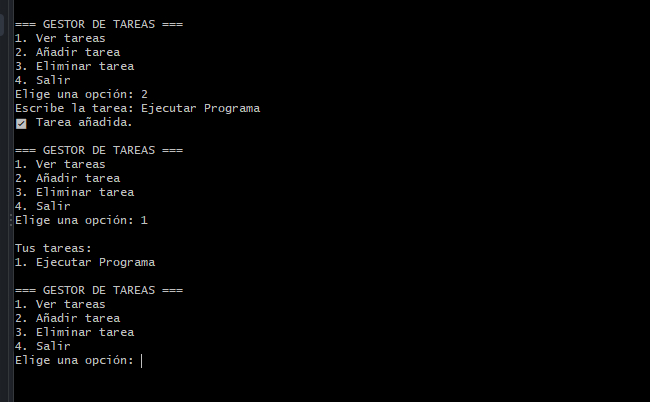

# MANUAL DE USUARIO

## Propósito del manual

Este manual tiene como propósito guiar al usuario en la utilización del sistema **Gestor de Tareas**, explicando cómo ejecutar el programa y cómo usar sus funciones principales.

<br aria-hidden="true">

## Cómo iniciar el proyecto

1. Abrir la terminal o consola de comandos.
2. Dirigirse a la carpeta donde está guardado el archivo `gestor_tareas.py`.

```bash
cd ruta_de_la_carpeta
```

3. Ejecutar el programa con el siguiente comando:

```bash
python gestor_tareas.py
```

o

```bash
py gestor_tareas.py
```

<br aria-hidden="true">

## Pasos para utilizar la función principal

### Añadir una tarea

1. Iniciar el programa.
2. Seleccionar la opción **2**.
3. Escribir el nombre de la tarea.
4. Presionar Enter.
5. La tarea quedará registrada en la lista.

### Ver tareas

1. Seleccionar la opción **1**.
2. El sistema mostrará todas las tareas almacenadas.

### Eliminar una tarea

1. Seleccionar la opción **3**.
2. Elegir el número de la tarea que desea eliminar.
3. La tarea será eliminada de la lista.

### Salir del programa

1. Seleccionar la opción **4**.
2. El programa finalizará.

<br aria-hidden="true">

## Resultado esperado

Al ejecutar el programa se mostrará el siguiente menú:

```text
=== GESTOR DE TAREAS ===
1. Ver tareas
2. Añadir tarea
3. Eliminar tarea
4. Salir
```

El usuario podrá gestionar sus tareas utilizando las opciones disponibles.

<br aria-hidden="true">

## Problema común y su solución

### Problema

Al ejecutar el programa aparece el siguiente mensaje:

```text
'python' no se reconoce como un comando interno o externo
```
### Solución
- Verificar que Python esté instalado.
- Reinstalar Python activando la opción **Add Python to PATH**.
- Reiniciar la terminal y volver a ejecutar el programa.
<br aria-hidden="true">

## Imagen o captura de evidencia
